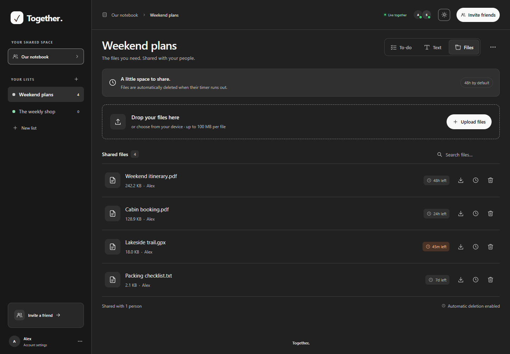
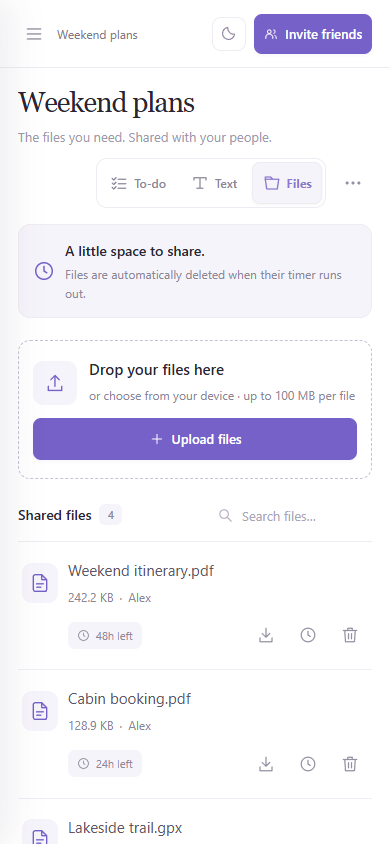
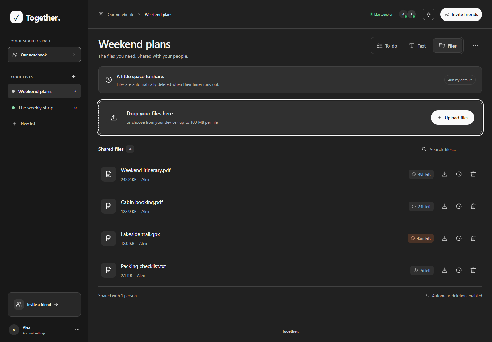
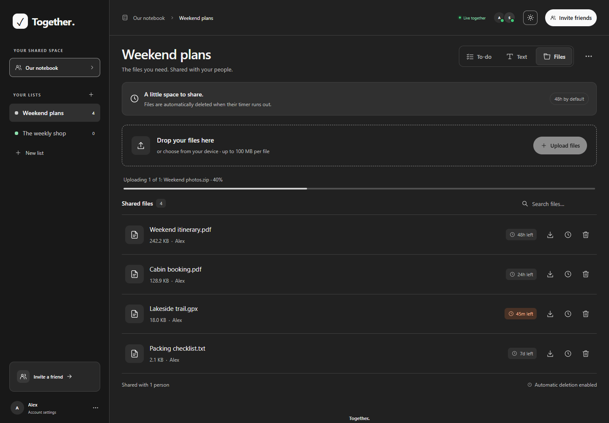
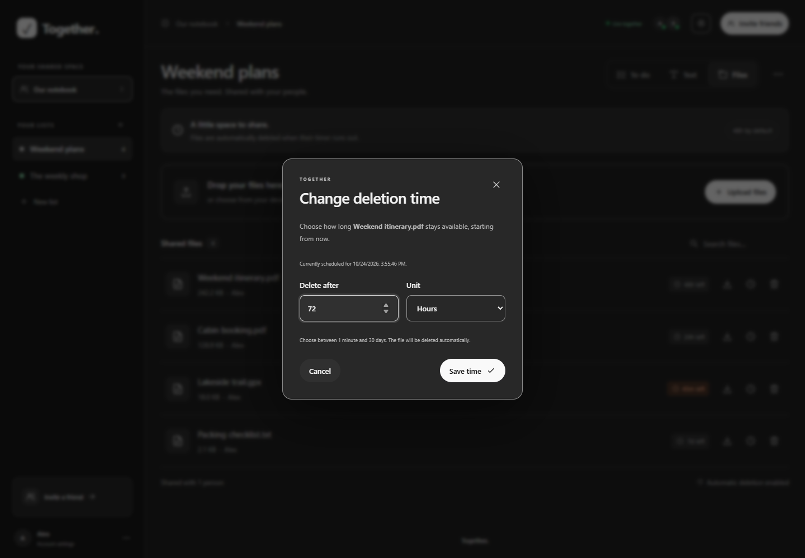

# Together

Private, shared to-do lists, text documents, and temporary file sharing for friends and small groups. Self-hosted with Node.js 24 and SQLite.

- Shared lists, task notes, search, and live updates.
- Switch each list between tasks and a shared text document. Add, rename, and delete text sheets using the tabs at the bottom. Text saves automatically and concurrent edits are merged live.
- Use **View as Markdown** in the text sheet toolbar to preview headings, lists, links, tables, and code blocks. Choose **Edit text** to return to the original text; the preview also follows live changes.
- Download a text sheet as **Plain text (.txt)** or **Markdown (.md)** using the download button in its toolbar. Both formats include the current text, including unsaved changes.
- Share files with multi-file uploads, drag and drop, upload progress, filename search, downloads, and manual deletion (up to 100 MB per file).
- Files expire automatically after 48 hours by default. Set a different deletion time for each file using the clock button beside download.
- Invite-only accounts with owner-managed access.
- Private lists with per-person view or edit permissions, including tasks, text sheets, and shared files.
- Responsive layout with light and dark themes.

## Quick start

```sh
docker compose up -d --build
```

Open [localhost:3000](http://localhost:3000), create the owner account, and share invitation links with friends. Create the owner account before making the app publicly accessible. Data persists in a Docker volume.

## Configuration

Copy `.env.example` to `.env` to customize the public `APP_URL`, `PORT`, and `BIND_ADDRESS`. Use HTTPS for public hosting. For direct LAN access, set `BIND_ADDRESS=0.0.0.0` and `APP_URL` to your server's address.

Without Docker: run `npm start` with Node.js 24+; no dependencies to install. Checks: `npm run check` and `npm test`.

Source code lives in `src/server/` (Node.js and SQLite) and `src/web/` (browser UI). Tests live in `tests/`.

Text sheets support up to 100,000 characters each. Keep the tab open until it says “All changes saved”; if saving fails, retry or download the local text using the document toolbar.

## File sharing

Open a list and select the **File share** icon beside the task and text document icons.

- Select **Upload files** to choose one or more files, or drag them into the **Drop your files here** area. The area highlights while dragging; uploads show the filename, percentage, and a progress bar. Each file can be up to 100 MB.
- Uploaded files appear one below another with their filename, size, uploader, and remaining time. Use **Search files** to filter by filename and the download button to save a copy.
- Use the **clock button beside download** to change a file’s deletion time. Choose a duration in minutes, hours, or days, from **1 minute to 30 days**. The new countdown starts when you save; the dialog also shows the currently scheduled deletion time.
- Use the trash button to delete a file immediately after confirming. Readers can download files; list owners and editors can also upload, change deletion times, and delete files.

Every completed upload starts with a **48-hour** lifetime. The server automatically deletes expired files from storage and updates connected browsers, even when no one has the list open. Downloads stop at expiry, and expired files cannot be extended. If the server was stopped, it cleans up overdue files on restart. Deleting a list also deletes its shared files.

### File storage

Files are stored on the server beside the SQLite database:

| Environment | Database | Uploaded files |
| --- | --- | --- |
| Local defaults | `data/together.sqlite` | `data/together.sqlite-files/` |
| Docker | `/app/data/together.sqlite` | `/app/data/together.sqlite-files/` |

Docker keeps both in the existing `together-data` volume. With a custom `DATABASE_PATH`, the upload directory is named `<database filename>-files/` in the same directory as that database. Files use random IDs on disk; their original names, sizes, uploaders, and deletion times are stored in SQLite. Back up both the database and its upload directory to preserve shared files.

## List permissions

New lists are private to their creator. Invite people to the notebook, then open a list’s **List options → Manage access** to give individual members **Can view**, **Can edit**, or **No access**. Changes take effect immediately on the server and refresh in connected tabs. Viewers can read tasks and download text sheets and shared files; editors can also rename the list, change its tasks and sheets, upload or delete files, and adjust file deletion times. Only the list creator can manage access or delete the whole list. Deleting a list also deletes its uploaded files. The notebook owner has no automatic access to another member’s private lists.

On the first upgrade, existing lists belong to the notebook owner and keep edit access for all existing members. Newly invited members receive no automatic list access. This migration runs once; subsequent restarts preserve private lists and permissions.

Removing a member revokes their sessions and list grants. Members who own lists must delete those lists before their account can be removed; removing an account never silently exposes or deletes its private lists. A revoked reader’s browser clears the list on its next successful refresh, but access controls cannot retract copies someone already read or downloaded.

## Screenshots

| Desktop · dark theme | Mobile · light theme |
| --- | --- |
|  |  |

Shared text document with multiple sheets:


### File sharing

The file list shows remaining lifetimes and the download, clock, and delete buttons:

| Desktop · dark theme | Mobile · light theme |
| --- | --- |
|  |  |

Dragging a file over the upload area highlights the drop target:



A real drag-and-drop upload in progress, with its filename, percentage, and progress bar:



The clock button opens the deletion-time dialog:



## License

[MIT](LICENSE) · Copyright © 2026 ValiOff8.
