# Together

A little less to remember. Private, shared to-do lists, collaborative notes, and temporary file sharing for friends and small groups.

Self-host Together with **Node.js 24+ and SQLite**, or start it with Docker Compose. Invite your people, share only the lists they need, and keep tasks, plans, and files in one place.

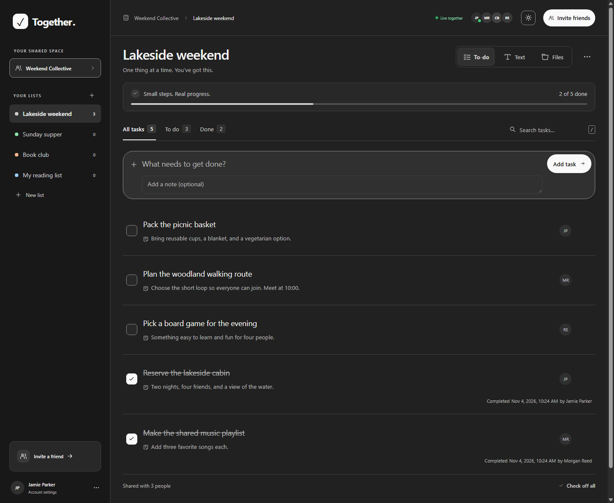

All screenshots use an entirely fictional demo notebook, **Weekend Collective**. Names, email addresses, tasks, notes, and files are made-up examples captured in the running app.

## What you can do

| Feature | Included |
| --- | --- |
| Shared tasks | Multiple lists, colors, optional notes, search, task filters, progress, completion history, and bulk actions. |
| Collaborative text | Multiple sheets per list, automatic saving, live merging of concurrent edits, Markdown preview, and text or Markdown downloads. |
| Temporary file sharing | Multiple uploads, drag and drop, upload progress, filename search, downloads, configurable deletion times, and manual deletion. |
| Invitations and permissions | Email-bound invitation links and separate view or edit access for each list. New lists start private. |
| Live updates | Changes appear in connected browsers, with connection status and collaborator avatars. |
| Personal preferences | Light and dark themes, responsive layouts, and remembered list, view, and task-filter selections. |

## Quick start

```sh
docker compose up -d --build
```

Open [localhost:3000](http://localhost:3000) and create the first account. This account becomes the notebook owner and can invite other people. Create it before making the app publicly accessible.

Docker stores the database and uploaded files in the persistent `together-data` volume.

### Configuration

Copy `.env.example` to `.env` to customize the Docker Compose settings:

| Setting | Default | Purpose |
| --- | --- | --- |
| `APP_URL` | `http://localhost:3000` | Public address people use to open Together. |
| `PORT` | `3000` | Port exposed on the Docker host. |
| `BIND_ADDRESS` | `127.0.0.1` | Host interface used by Docker Compose. |

Use HTTPS for public hosting. For direct access on your local network, set `BIND_ADDRESS=0.0.0.0` and set `APP_URL` to your server's address.

### Run without Docker

With Node.js 24 or later installed:

```sh
npm start
```

There are no dependencies to install. The server listens on all interfaces, using `PORT=3000` by default. For a native installation, set `APP_URL`, `PORT`, and `DATABASE_PATH` through your process environment; `.env` is used by Docker Compose and is not loaded automatically by `npm start`. The default database path is `data/together.sqlite`.

## Tasks that keep everyone on the same page

Create a list, give it a color, and add tasks with optional notes. Search task titles and notes, switch between **All tasks**, **To do**, and **Done**, and see how much is already finished.

Tasks show who last changed them. Open a task to see its full notes and creation and update details. Completed tasks record who checked them off and when. Use **Check off all** to finish the remaining tasks, or open **Done** to delete completed tasks in one action after confirmation.

The browser remembers your selected list, task filter, and **To-do**, **Text**, or **Files** view when you return.

| Desktop, dark theme | Mobile, dark theme |
| --- | --- |
|  | 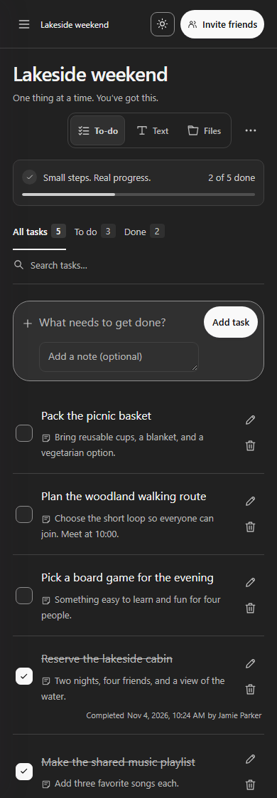 |

<details>
<summary>See task notes and edit history</summary>

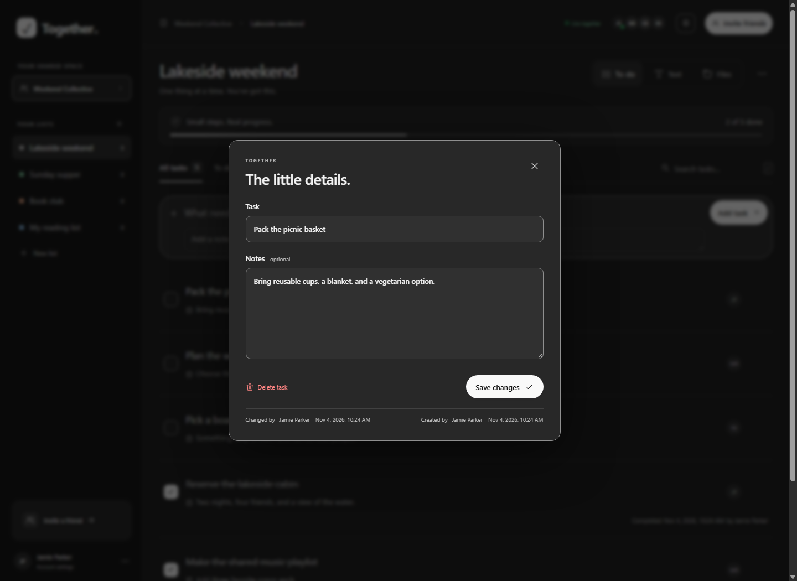

</details>

## Write together, preview Markdown, and take a copy

Select **Text** in any list to open its shared text sheets. Use the tabs and plus button at the bottom to switch or add sheets, and the toolbar to rename or delete them. Changes save automatically, and concurrent edits merge live.

Choose **View as Markdown** to preview headings, checklists, links, tables, and code blocks. Choose **Edit text** to return to the source. The preview follows live changes too.

The download button offers **Plain text (.txt)** and **Markdown (.md)**. Both include the current local text, including changes that have not finished saving.

| Shared text editor, dark theme | Markdown preview, dark theme |
| --- | --- |
| 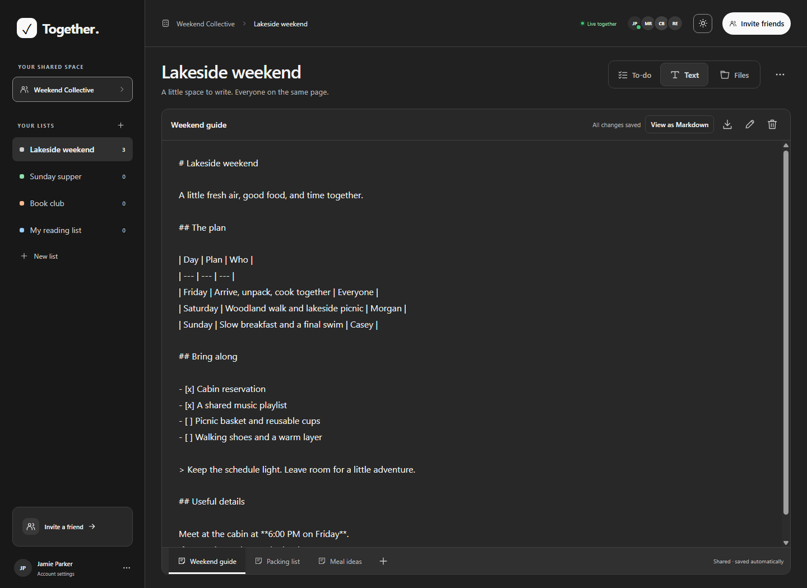 | 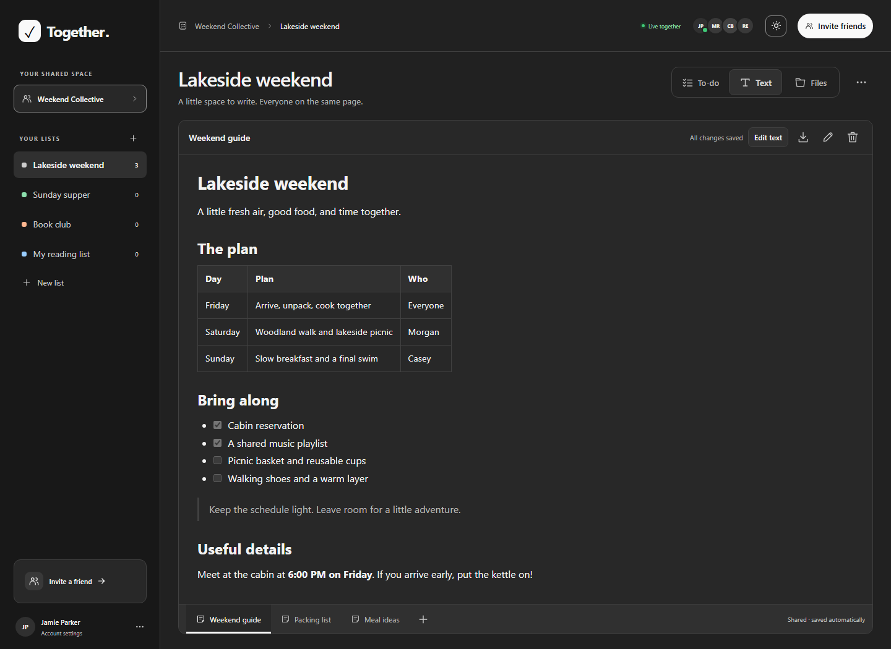 |

Each sheet supports up to **100,000 characters**. Keep the tab open until the status says **All changes saved**. If saving fails, retry or download the local text before closing the tab.

<details>
<summary>See text and Markdown export options</summary>

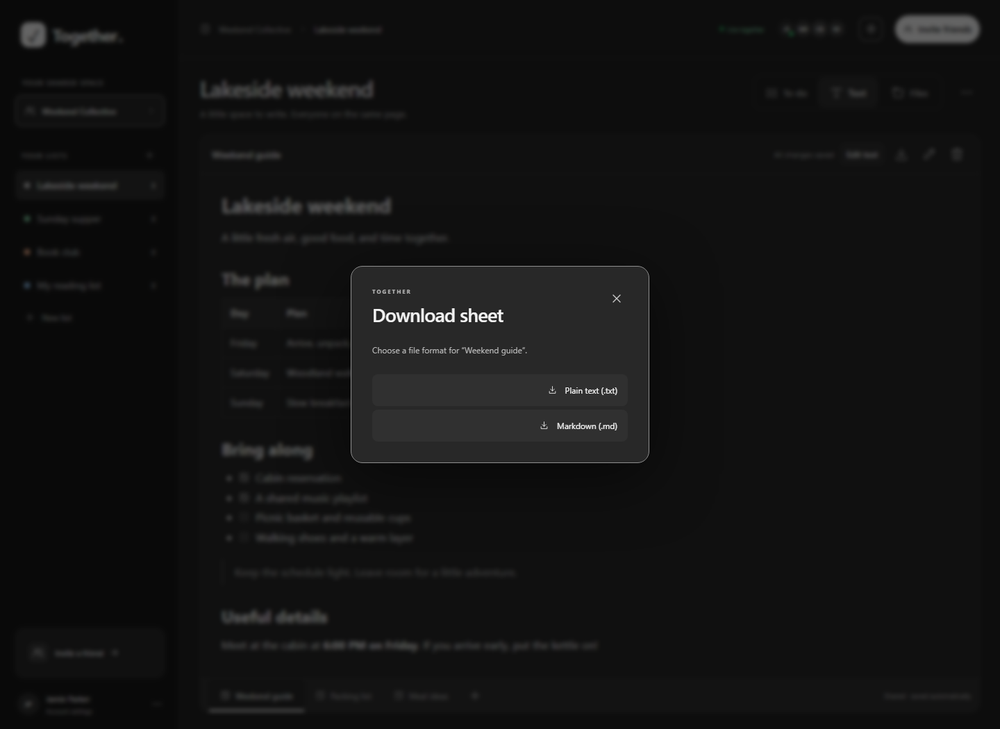

</details>

## Share files with an automatic cleanup timer

Select **Files** in any list. Choose **Upload files** to select multiple files, or drag them into the upload area. Uploads show the current filename, percentage, and progress bar.

The file list shows each filename, size, uploader, and remaining lifetime. Search by filename, download a copy, change its deletion time with the clock button, or delete it immediately after confirmation.

| Desktop, dark theme | Mobile, dark theme |
| --- | --- |
| 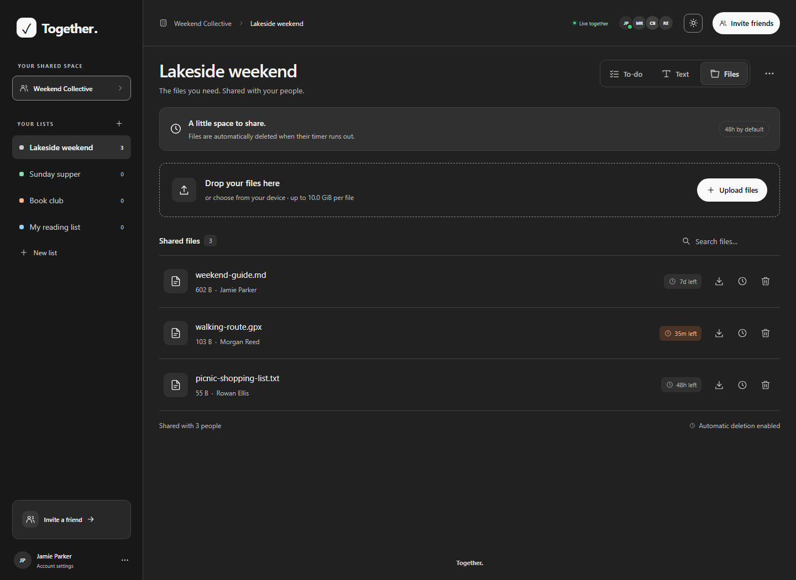 | 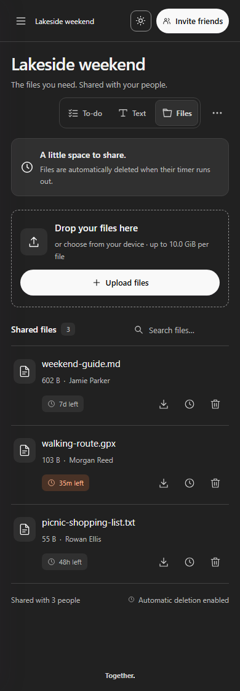 |

### File lifetimes

Every completed upload starts with a **48-hour** lifetime. The clock button lets list owners and editors choose a new duration from **1 minute to 30 days**, in minutes, hours, or days. The countdown starts when the change is saved.

The server deletes expired files from storage and updates connected browsers even when nobody has the list open. Downloads stop at expiry; expired files cannot be extended. If the server was stopped, overdue files are cleaned up on restart. Deleting a list also deletes its uploaded files.

<details>
<summary>See drag and drop, a real upload in progress, and the deletion-time dialog</summary>

The drop target highlights when a file is dragged over it:

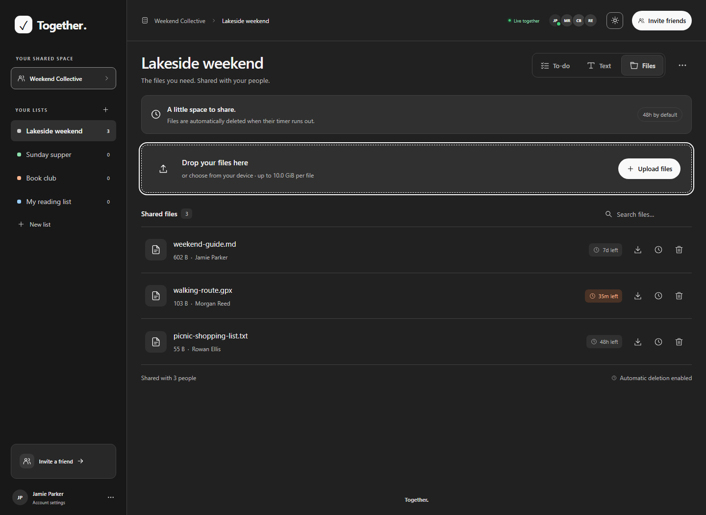

A real demo upload in progress:

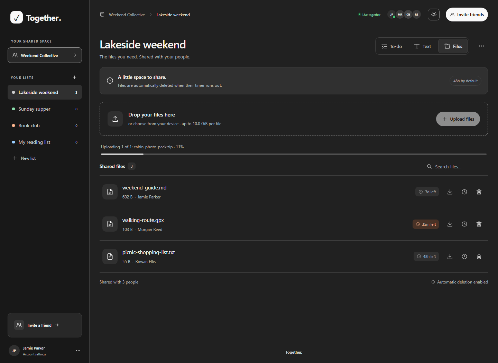

The deletion-time dialog shows the current schedule and a choice of units:

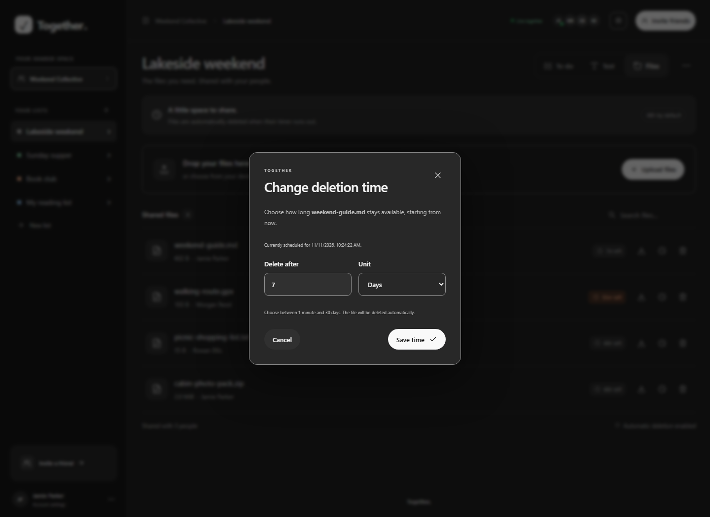

</details>

### Upload size limit

The default limit is **10 GiB per file**. The notebook owner can click the notebook name in the sidebar, set **Maximum size per file** in bytes, MiB, or GiB, and select **Save upload limit**. This setting persists across restarts and updates in connected browsers.

The limit applies to each new upload, including streamed uploads without a declared size. An upload already in progress uses the limit in effect when it started; existing files remain available. Values must be positive whole bytes, up to 9,007,199,254,740,991 bytes. One MiB is 1,048,576 bytes; one GiB is 1,073,741,824 bytes.

Browser and server uploads have a 24-hour time limit. Configure reverse-proxy request-size and timeout limits to accommodate the uploads you allow, and provide enough free disk space.

<details>
<summary>See notebook settings and the upload limit</summary>

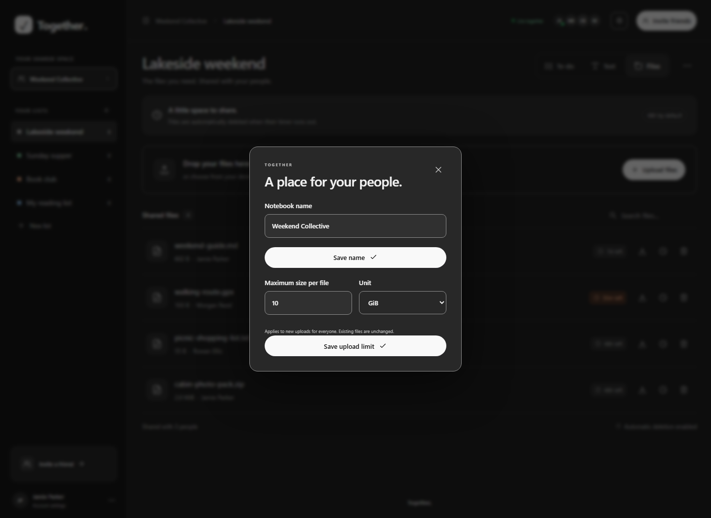

</details>

## Invite your people and choose what they can access

The notebook owner creates personal invitation links using **Invite friends**. Links are bound to the invited email address, expire after **7 days**, can be revoked, and can only be used once. Share the link yourself; Together does not send an email automatically.

New lists are private to their creator. Invite people to the notebook, then open **List options → Manage access** to share an individual list.

| Permission | What it allows |
| --- | --- |
| **No access** | The list and its contents are unavailable to that member. |
| **Can view** | Read tasks and text sheets, and download text sheets and shared files. |
| **Can edit** | Everything viewers can do, plus rename the list, change tasks and sheets, upload or delete files, and adjust file deletion times. |
| **List creator** | Full access, including managing permissions and deleting the entire list. |

Permissions apply to tasks, text sheets, and files together. The notebook owner has no automatic access to another member's private lists. Newly invited members receive no automatic list access.

| Invitations and members | Per-person list permissions |
| --- | --- |
| 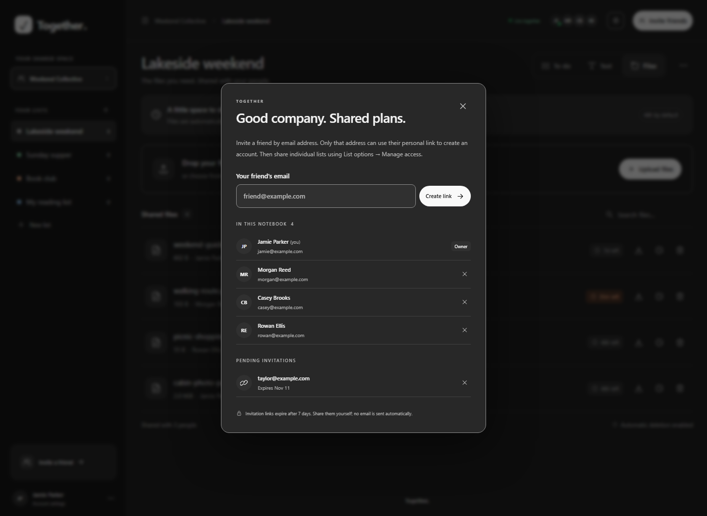 | 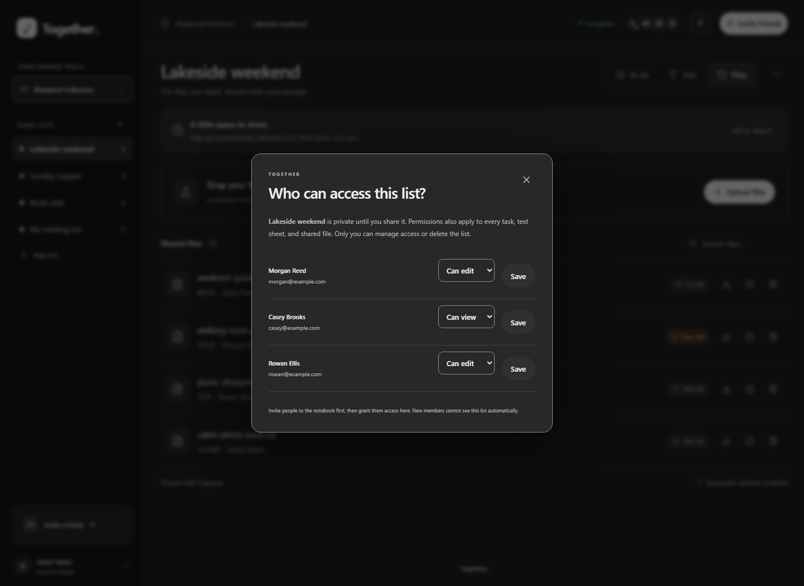 |

Access changes take effect immediately on the server and refresh in connected tabs. Removing a member revokes their sessions and list grants. Members who own lists must delete those lists before their account can be removed; removal never silently exposes or deletes their private lists. Access controls cannot retract copies someone has already read or downloaded.

On the first upgrade from an older installation without private lists, existing lists belong to the notebook owner and retain edit access for existing members. This migration runs once; subsequent restarts preserve list ownership and permissions.

## Light theme examples

Prefer a brighter workspace? Switch themes with the button in the top bar. The light theme uses dark text and clear control outlines on pale surfaces. Your browser remembers your choice.

| Desktop, light theme | Mobile, light theme |
| --- | --- |
| 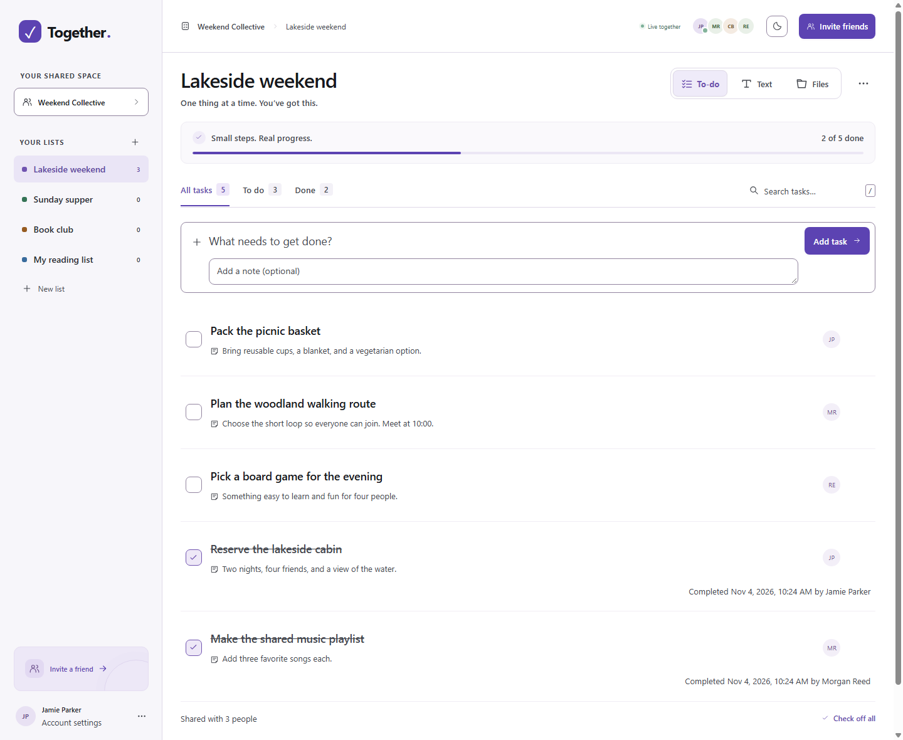 | 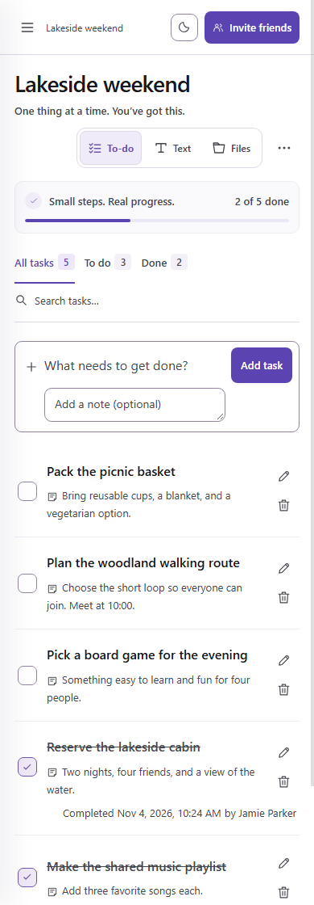 |

## Storage and backups

| Environment | Database | Uploaded files |
| --- | --- | --- |
| Local defaults | `data/together.sqlite` | `data/together.sqlite-files/` |
| Docker | `/app/data/together.sqlite` | `/app/data/together.sqlite-files/` |

Docker keeps both in the `together-data` volume. With a custom `DATABASE_PATH`, the upload directory is named `<database filename>-files/` beside the database. Files use random IDs on disk; original names, sizes, uploaders, and deletion times are stored in SQLite.

Back up both the database and its upload directory to preserve shared files. Stop the app while taking a filesystem backup so the database and uploads are captured consistently.

## Account settings and recovery

Open your profile in the sidebar to change your password or sign out. Changing a password signs out other sessions for that account.

If an account needs a password reset, run the interactive recovery tool on the server:

```sh
docker compose exec -it together node src/server/reset-password.mjs jamie@example.com
```

Replace the fictional email address with the account to recover. The tool prompts for a new password without displaying it and signs out all existing sessions for that account. For a native installation, run `node src/server/reset-password.mjs EMAIL` with the same `DATABASE_PATH` as the app.

## Development

```sh
npm run dev
npm run check
npm test
```

`npm run dev` restarts the server when source files change. Source code lives in `src/server/` for Node.js and SQLite and `src/web/` for the browser UI. Tests live in `tests/`.

## License

[MIT](LICENSE) · Copyright © 2026 ValiOff8.
