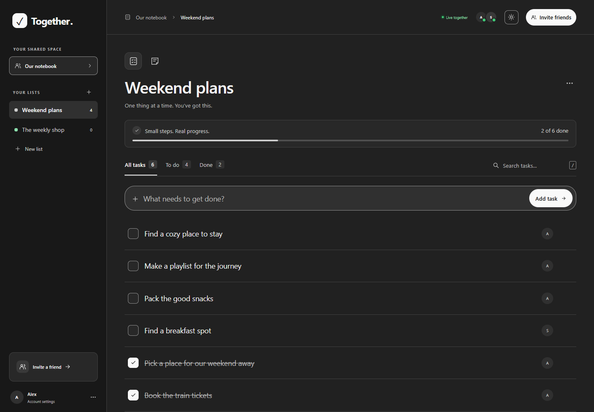
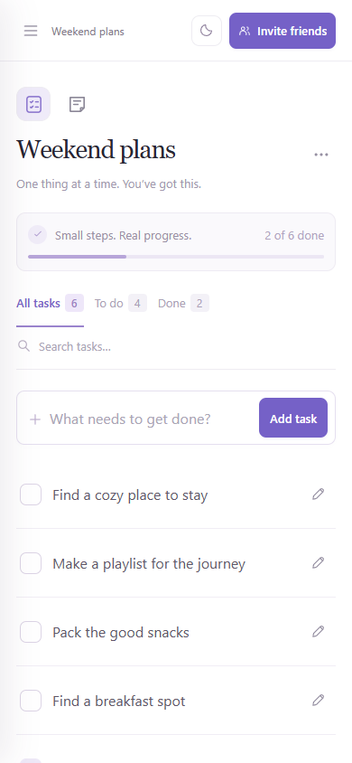
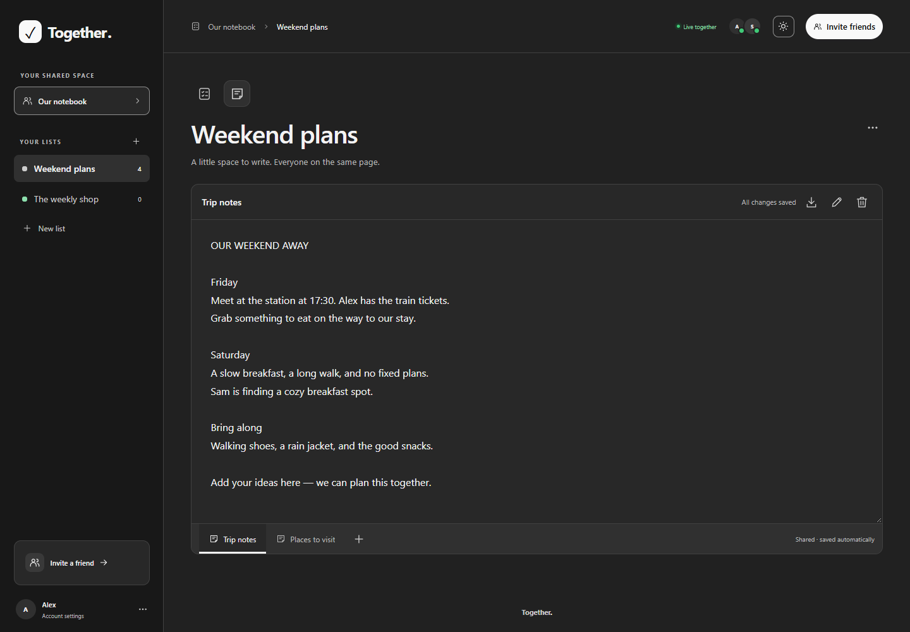

# Together

Private, shared to-do lists for friends and small groups. Self-hosted with Node.js 24 and SQLite.

- Shared lists, task notes, search, and live updates.
- Switch each list between tasks and a shared text document. Add, rename, and delete text sheets using the tabs at the bottom. Text saves automatically and concurrent edits are merged live.
- Use **View as Markdown** in the text sheet toolbar to preview headings, lists, links, tables, and code blocks. Choose **Edit text** to return to the original text; the preview also follows live changes.
- Download a text sheet as **Plain text (.txt)** or **Markdown (.md)** using the download button in its toolbar. Both formats include the current text, including unsaved changes.
- Switch to **File share** beside tasks and text documents to upload or drop files (up to 100 MB each). Files appear in a searchable list with download and delete buttons and their remaining lifetime. Readers can download; editors can upload and delete.
- Shared files default to a 48-hour lifetime after each completed upload. Editors can use the clock button beside download to set a new deletion time from now, between 1 minute and 30 days, in minutes, hours, or days. The server deletes expired files automatically, including while no browser is open, and cleans up overdue files when it restarts. Downloads stop at expiry. Uploads persist next to the database in `together.sqlite-files/`, inside the existing Docker data volume.
- Invite-only accounts with owner-managed access.
- Private lists with per-person view or edit permissions, including tasks and text sheets.
- Responsive layout with light and dark themes.

## Quick start

```sh
docker compose up -d --build
```

Open [localhost:3000](http://localhost:3000), create the owner account, and share invitation links with friends. Create the owner account before making the app publicly accessible. Data persists in a Docker volume.

## Configuration

Copy `.env.example` to `.env` to customize the public `APP_URL`, `PORT`, and `BIND_ADDRESS`. Use HTTPS for public hosting. For direct LAN access, set `BIND_ADDRESS=0.0.0.0` and `APP_URL` to your server's address.

Without Docker: run `npm start` with Node.js 24+; no dependencies to install. Checks: `npm run check` and `npm test`.

Source code lives in `src/server/` (Node.js and SQLite) and `src/web/` (browser UI). Tests live in `tests/`.

Text sheets support up to 100,000 characters each. Keep the tab open until it says “All changes saved”; if saving fails, retry or download the local text using the document toolbar.

## List permissions

New lists are private to their creator. Invite people to the notebook, then open a list’s **List options → Manage access** to give individual members **Can view**, **Can edit**, or **No access**. Changes take effect immediately on the server and refresh in connected tabs. Viewers can read tasks and download text sheets and shared files; editors can also rename the list, change its tasks and sheets, and upload or delete files. Only the list creator can manage access or delete the whole list. Deleting a list also deletes its uploaded files. The notebook owner has no automatic access to another member’s private lists.

On the first upgrade, existing lists belong to the notebook owner and keep edit access for all existing members. Newly invited members receive no automatic list access. This migration runs once; subsequent restarts preserve private lists and permissions.

Removing a member revokes their sessions and list grants. Members who own lists must delete those lists before their account can be removed; removing an account never silently exposes or deletes its private lists. A revoked reader’s browser clears the list on its next successful refresh, but access controls cannot retract copies someone already read or downloaded.

## Screenshots

| Desktop · dark theme | Mobile · light theme |
| --- | --- |
|  |  |

Shared text document with multiple sheets:



## License

[MIT](LICENSE) · Copyright © 2026 ValiOff8.
